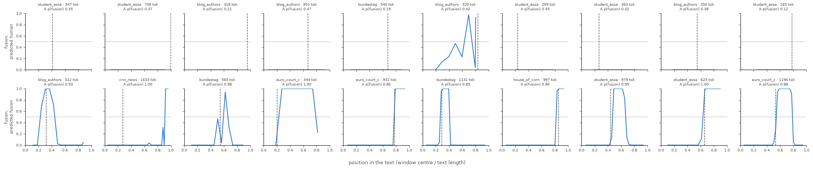

# HW3: Detecting human, AI and fusion texts (EN + DE)

**Author:** Pavlo Ruzhylo · **Final Kaggle submissions:** `submissions/final_p6_logreg.csv` and `curves_E2_hgb.csv`) · **Public / private LB:** 0.96461 / 0.95923

## 1. Data and validation protocol

**The task**: classify text into three classes: human, ai or fusion (a mix of both).
**The data**: 272k train/25k test, 8 domains, 81% en 19% de. human 24.5% ai 44.8% fusion 30.7% -- imbalance. Macro-F1 weights each class equally.
**Main EDA findings:** 
- fusion texts often (72%) copy a human text word for word (same 200 char prefix; median 191 words copied). I never put these twins into different folds. Test has no such cases.
- german is mostly `bundestag` domain.
- AI makes about 5x fewer errors. Typos and other errors separate human texts a lot.
- Most texts are longer than 512 tokens

**Fixed split:** `splits/train_folds.csv` , 0 is validation, all comparisons use this fold. has 10 folds, stratified by label x language, grouped by this prefix.

## 2. Baseline: TF-IDF + linear model (`baseline_tfidf.ipynb`)
A TF-IDF with two views: word 1-2-grams (lowercased) and char_wb 3-5 grams (case kept, since there are many typos such as lowercase i that separate human text well)
Vectorizers and models are fitted on 50k stratified sample of training folds (label x language under fixed seed), scored on full val fold.
Same 50k sample is used with encoder in sec. 3
**Grid**:
- Features: `{word, char, word + char}`
- Models: LinearSVC with C in `{0.1, 0.3, 1}` 
- Class weights: `{None, Balanced}`

Best: word+char, LinearSVC C=1, balanced → **macro-F1 0.8599** (human 0.794, ai 0.983, fusion 0.803). Class weights help only slightly (+0.0004). Public LB: 0.85.  
(Later I tried Logistic regression (C=30, balanced) separately on the same features and LB got better: 0.874/0.883 private/public. Unfortunately didn't save the LogReg val score)

## 3. Encoder: fine-tuned XLM-R base, "Branch A" (`hw3-encoder-tuning.ipynb`)
Used same 50k sample and val fold for comparison. 2 epochs, lr 2e-5, AdamW with linear decay and 6% warmup, weight decay 0.01.
63% of texts are longer than 512 tokens so I split them into 512 token windows with 128 tokens overlap. I also keep at most 4 windows per text when training. Each window gets own prediction. Then, there are two probabilities for text: first window, or the mean over all windows.
Results: 0.864 for first, 0.902 for mean, with fusion getting the most gain in between (0.821 -> 0.880), which aligns with EDA: likely ai text starts after human finished.
Human F1 was the lowest (0.836) it predicted too few human and too much fusion, likely mistaking the two. This motivates section 4.
**Private/Public LB**: 0.895/0.896

## 4. Own approach: p(AI) curves along the text (`curves_check.ipynb`, `curve_stacker.ipynb`)

The hypothesis/idea: a fusion text is a human start + AI-written tail. Even if not, it likely looks like consecutive patches of human vs ai text. This motivates a binary classification for smaller windows: P(AI) curve. It should be low at the start and high at the end, or generally unstable: low intervals vs high intervals (e.g. shape).
**Training**
- **Base**: take Branch A with a new 2-class head. It's trained only on human vs ai texts of the detector set, fusion is left out. Take windows of 128 and 256 tokens, at most 6 per text, 2 epochs with lr 2e-5.
- **Scoring**: windows of size 64/128/256 tokens, a new window every size/4 tokens.
- **Feature extraction** from curve (66 per text, all window sizes). Basic: mean, max, std, share of high windows, longest high run, jumps, switches. The best single step up, the most AI-like stretch, number of windows, length, cross-scale agreement between window sizes.
- **Stacker takes** as inputs log probabilities from sec. 3, and curve features from own approach. It is fitted on the stacker set only (30k texts neither model saw). Grid: LogReg, HGB, 5-fold CV, class weights tuned on OOF probabilities. As a control, I tried adding class weights alone on Branch A, gain is +0.006. A stacker trained on Branch A alone produced the same gain.

**Main result**: Branch A + curves (HGB): 0.9344 (+0.032 vs Branch A's 0.902, 95 % CI [0.028, 0.036]). Human became 0.836 → 0.900, fusion 0.880 → 0.910. Fewer human texts are called fusion now.
**Private/public LB score: 0.932/0.934**
## 5. Final model: four-input stacker (`final_stacker.ipynb`)

Idea: remove the limitations of branch A (512 token windows) and use bigger encoder that reads the whole text. Additionaly add LLM signal that needs no training.
**Models** 
- *BGE-M3 (XLM-R large)*, up to 4096 tokens now gives one prediction per text. It's trained on 100k texts of own set, kept apart from stacker and validation. 2 epochs, lr 1e-5. Took 22 min on 4xGH200 :). Alone: 0.9587 vs 0.902 on branch A.
- *Qwen3-8B*: per-token log-prob and entropy turned into P(AI) per window by logistic regression fitted on detector set, and same curve features extracted. Alone gave 0.7147

**Stacker:** same as section 4 but +2 inputs now. Compared combinations of the 4 inputs by CV on the stacker set; all four gives the best result (val 0.9624). LogReg C=0.1, chosen by best CV score on separate stacker set, not by val. Per-class F1: 0.941 for human, 0.996 for AI and 0.950 for fusion.
**Private/public LB score: 0.959/0.964**

## 6. What did not work
- Curves alone 0.8956: They only help next to an encoder.
- Qwen alone 0.7147. 
- Once encoder v2 is in, the curves add little: 0.9612 vs 0.9605.
- Truncation to 512 tokens (0.864) vs window mean (0.902) (encoder).

## 7. Explainability (`final_xai.ipynb`, bonus)

The final model is linear in features so the decision is easily interpreted as one contribution per input: encoder 56%, curves 16%, encoder v1 16% qwen 13%. More on bonus: see final_xai.ipynb
|  |  |  |  |  |
|---|---|---|---|---|
|  |  |  |  |  |
|  |  |  |  |  |
|  |  |  |  |   |
|  |  |  |  |  |
|  |  |  |  |  |
|  |  |  |  |  |
|  |  |  |  |  |
|  |  |  |  |  |
|  |  |  |  |  |

---

## Appendix A. Results (validation fold 0, macro-F1; leaderboard private / public)

**A1. Main path**

| Model | Val macro-F1 | F1 human | F1 ai | F1 fusion | LB private / public |
|---|---|---|---|---|---|
| TF-IDF word+char, LinearSVC (C=1, balanced) | 0.8599 | 0.794 | 0.983 | 0.803 | – / 0.85 |
| XLM-R base, first 512 tokens only | 0.8640 | 0.783 | 0.988 | 0.821 | – |
| XLM-R base, mean over 512-token windows | 0.9020 | 0.836 | 0.990 | 0.880 | 0.895 / 0.896 |
| XLM-R windows + p(AI) curve features (gradient boosting) | 0.9344 | 0.900 | 0.993 | 0.910 | 0.932 / 0.934 |
| BGE-M3 on whole texts, alone | 0.9587 | 0.935 | 0.995 | 0.946 | – |
| **Final: BGE-M3 + XLM-R + curves + Qwen (logistic regression)** | **0.9624** | **0.941** | **0.996** | **0.950** | **0.959 / 0.964** |

**A2. Baseline grid (LinearSVC, 50k sample): best C per feature set**

| Features | No class weights | Balanced |
|---|---|---|
| word 1–2-grams | 0.8347 | 0.8358 |
| char_wb 3–5-grams | 0.8505 | 0.8521 |
| word + char | 0.8595 | **0.8599** |

**A3. Long-text handling (same XLM-R model, F1 per class)**

| Aggregation | macro-F1 | human | ai | fusion |
|---|---|---|---|---|
| First window (truncation) | 0.8640 | 0.783 | 0.988 | 0.821 |
| Mean over all windows | 0.9020 | 0.836 | 0.990 | 0.880 |
| Gain | +0.038 | +0.053 | +0.002 | +0.059 |

**A4. What the curve stacker needs** (gain over XLM-R windows alone, 0.9023; 95 % paired bootstrap CI)

| Stacker input | Val macro-F1 | Gain | CI |
|---|---|---|---|
| XLM-R + tuned class weights only (no stacker) | 0.9085 | +0.006 | – |
| Stacker on XLM-R probabilities only | 0.9081 | +0.006 | [0.003, 0.009] |
| Curve features only (no encoder) | 0.8956 | −0.007 | [−0.011, −0.002] |
| XLM-R + 64-token curves | 0.9256 | +0.023 | [0.020, 0.027] |
| XLM-R + 128-token curves | 0.9292 | +0.027 | [0.023, 0.031] |
| XLM-R + 256-token curves | 0.9266 | +0.024 | [0.020, 0.028] |
| XLM-R + 128 & 256-token curves | 0.9322 | +0.030 | [0.026, 0.034] |
| XLM-R + all sizes, half as many windows | 0.9316 | +0.029 | [0.025, 0.033] |
| XLM-R + all sizes, basic curve statistics only | 0.9320 | +0.030 | [0.026, 0.033] |
| XLM-R + all sizes, all features (logistic regression) | 0.9323 | +0.030 | [0.026, 0.034] |
| **XLM-R + all sizes, all features (gradient boosting)** | **0.9344** | **+0.032** | **[0.028, 0.036]** |

**A5. Final stacker: which inputs matter** (logistic regression or gradient boosting, chosen by 5-fold CV on the stacker set)

| Inputs | CV (stacker set) | Val macro-F1 | F1 fusion |
|---|---|---|---|
| Qwen3-8B log-prob features only | 0.7128 | 0.7147 | 0.633 |
| XLM-R + curves (previous model) | 0.9397 | 0.9344 | 0.910 |
| XLM-R + curves + Qwen | 0.9403 | 0.9363 | 0.913 |
| BGE-M3 only | 0.9621 | 0.9605 | 0.948 |
| BGE-M3 + Qwen | 0.9624 | 0.9604 | 0.948 |
| BGE-M3 + curves | 0.9629 | 0.9612 | 0.949 |
| BGE-M3 + curves + Qwen | 0.9634 | 0.9613 | 0.948 |
| **All four (final)** | **0.9641** | **0.9624** | **0.950** |

**A6. Confusion matrices** (rows: true class, share of the row)

| True ↓ / predicted → | XLM-R windows: human · ai · fusion | + curves: human · ai · fusion | Final: human · ai · fusion |
|---|---|---|---|
| human | **0.775** · 0.010 · 0.214 | **0.943** · 0.002 · 0.054 | **0.956** · 0.003 · 0.041 |
| ai | 0.001 · **0.996** · 0.003 | 0.003 · **0.991** · 0.006 | 0.002 · **0.995** · 0.003 |
| fusion | 0.061 · 0.016 · **0.924** | 0.118 · 0.004 · **0.878** | 0.058 · 0.004 · **0.939** |

**A7. What the final model relies on** (validation)

| Input | Columns | Share of fusion-vs-human decision | Macro-F1 drop when shuffled |
|---|---|---|---|
| BGE-M3 probabilities | 3 | 55.7 % | 0.519 |
| XLM-R window probabilities | 3 | 15.6 % | 0.006 |
| p(AI) curve features | 66 | 16.2 % | 0.012 |
| Qwen3-8B features | 64 | 12.5 % | 0.004 |

## Appendix B. Figures

**B1. p(AI) curves of validation fusion texts.** Top: texts XLM-R called human. Bottom: texts it called fusion. Dashed line: where the copied human text ends.



## Appendix C. How to reproduce

```bash
uv sync                                   # CPU environment (pyproject.toml)
# 1. notebooks/eda.ipynb                  -> splits/train_folds.csv (fixed split, fold 0 = validation)
# 2. notebooks/baseline_tfidf.ipynb       -> TF-IDF baseline submission
# 3. notebooks/hw3-encoder-tuning.ipynb   -> XLM-R windows (Kaggle, GPU T4 x2)
# 4. notebooks/curves_check.ipynb         -> splits/curve_roles.csv, gate_texts.csv, encoder_train.csv
# 5. GPU jobs, see cluster/README.md:
make -C cluster full                      #   window detector + curves + XLM-R probabilities
make -C cluster encoder2                  #   BGE-M3 on whole texts
make -C cluster qwen                      #   Qwen3-8B log-probabilities
make -C cluster pull                      #   copy results to cluster/results/
# 6. notebooks/curve_stacker.ipynb        -> submissions/curves_E2_hgb.csv
# 7. notebooks/final_stacker.ipynb        -> submissions/final_p6_logreg.csv (final)
# 8. notebooks/final_xai.ipynb            -> explanations, figures/final_model_explanations.html
```
